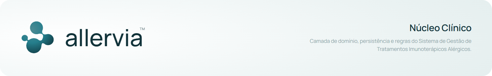

# Allervia · Núcleo Clínico

**Camada de domínio, persistência e regras do Sistema de Gestão de Tratamentos Imunoterápicos Alérgicos.**



API REST para gestão de tratamentos de imunoterapia com alérgenos. O sistema controla o ciclo completo de uma terapia: cadastro da instituição e da equipe clínica, cadastro de pacientes, prescrição da imunoterapia, agendamento automático das aplicações segundo o protocolo clínico e registro de cada dose administrada, com rastreabilidade de autoria em todas as operações.

---

## Sumário

- [Stack](#stack)
- [Arquitetura](#arquitetura)
- [Estrutura de diretórios](#estrutura-de-diretórios)
- [Segurança e autorização](#segurança-e-autorização)
- [Modelo de dados](#modelo-de-dados)
- [Regras clínicas](#regras-clínicas)
- [Como rodar](#como-rodar)
- [Variáveis de ambiente](#variáveis-de-ambiente)
- [Scripts disponíveis](#scripts-disponíveis)
- [Testes](#testes)
- [Endpoints](#endpoints)
- [Tratamento de erros](#tratamento-de-erros)
- [Fluxo de onboarding](#fluxo-de-onboarding)
- [Convenções de código](#convenções-de-código)

---

## Stack

| Camada | Tecnologia |
| --- | --- |
| Runtime | Node.js + TypeScript 5.7 |
| Framework | NestJS 11 |
| Banco de dados | PostgreSQL |
| ORM | Prisma 7 (driver adapter `@prisma/adapter-pg` sobre `pg`) |
| Autenticação | Sessão opaca em cookie `__Host-` HttpOnly (hash no banco) + CSRF (double-submit pré-auth e HMAC por sessão) + MFA TOTP (`otplib`) |
| Autorização | CASL (`@casl/ability` + `@casl/prisma`) |
| Hash de senha | bcrypt |
| Validação | `class-validator` / `class-transformer` via `ValidationPipe` global |
| Documentação de API | Swagger (`@nestjs/swagger`), gerada a partir do código |
| Identificadores | ULID |
| Testes | Jest + ts-jest + Supertest + `@faker-js/faker` |
| Qualidade | ESLint + Prettier + madge (ciclos e órfãos de dependência) |

---

## Arquitetura

O back-end é um **monolito modular** organizado por **domínio de negócio**, não por camada técnica. Cada contexto delimitado (*bounded context*) é um diretório em `src/` com seus próprios controladores, casos de uso, DTOs, repositórios e, quando justificado, entidades de domínio.

### Contextos delimitados

| Contexto | Responsabilidade |
| --- | --- |
| `security` | Autenticação (sessão opaca, MFA, CSRF, recuperação de senha) e autorização (CASL, papéis) |
| `account` | Conta de usuário: perfil, troca de senha, estatísticas |
| `organization` | Instituição ou clínica, raiz do isolamento multi-tenant, provisionamento inicial |
| `professionals` | Profissionais vinculados à organização e gestão de acesso |
| `patients` | Pacientes da organização |
| `invites` | Convites de usuários internos e registro a partir do convite |
| `treatment-protocols` | Núcleo clínico: terapias, doses e regras de protocolo |
| `scheduling` | Agendamentos (`Appointment`) ligados às doses e ao calendário externo |
| `audit` | Consulta ao log de auditoria (`AuditLog`), por entidade ou por autor |
| `notifications` | Notificações internas, preferências e outbox transacional |
| `public-requests` | Rotas públicas de contato/demo e solicitações de suporte autenticadas |
| `integrations/google-calendar` | OAuth por profissional, sincronização bidirecional de agenda e webhook de push |
| `infra` | Recursos compartilhados: Prisma, e-mail, exceções, filtros, health check, paginação HTTP, retenção/expurgo |

### Critério de modelagem

A estrutura interna de um módulo **não é uniforme**. A regra é única:

> Cria-se entidade de domínio quando o agregado tem **invariante** ou **máquina de estados** que se queira verificar sem depender do banco.

Consequências práticas:

- **Agregado rico** (com entidade de domínio): o convite (`UserInvite`), com lógica temporal própria de validade e consumo. No núcleo clínico, as invariantes vivem nos services transacionais (`ConfiguredDoseService`, `TherapyLifecycleService`) com locks e idempotência, reforçadas por triggers no banco; `Dose` e `Immunotherapy` são objetos de leitura.
- **Agregados de cadastro** (sem entidade): `Patient`, `User`, `Professional`, `Organization`. Trabalham direto com os tipos gerados pelo Prisma; a validação de formato ocorre no DTO, na borda da aplicação.

O rigor de modelagem e a cobertura de teste se concentram onde o defeito custa caro, que é a regra clínica de dosagem, em vez de se diluírem em cerimônia sobre CRUD.

### Camadas

1. **Controlador**: recebe a requisição, declara a intenção de autorização, delega ao caso de uso e devolve **sempre um DTO**, nunca a entidade interna. Sem lógica de negócio.
2. **Caso de uso**: uma classe por operação (`create-dose.use-case.ts`, `archive-user.use-case.ts` e assim por diante). Orquestra entidades, repositórios e regras; aplica o escopo de autorização por registro antes de ler ou gravar; abre transação quando o fluxo grava em mais de uma tabela. Não conhece HTTP.
3. **Repositório**: contrato como classe abstrata (que serve de interface e de token de injeção) mais implementação Prisma, ambos na raiz do módulo. Exemplos: `role.repository.ts` e `prisma-user-auth.repository.ts`.
4. **Domínio**: só nos módulos que o critério justifica. Entidades puras, exceções de domínio e interfaces, sem dependência de framework.

O grafo de dependências entre módulos é unidirecional e sem ciclos, verificável com `npm run deps:circular`.

### Padrões aplicados

- **Strategy + Factory** no fluxo de convite e registro (`invite-strategy.factory.ts`, `register-strategy.context.ts`). Hoje existe uma única estratégia concreta de cada lado — a estrutura foi mantida deliberadamente (decisão registrada em `docs/review/execucao/decisoes.md`), mas não adicione novas indireções sem uma segunda estratégia real.
- **Service com interface abstrata** para dependências substituíveis: `IEmailService`, `IPasswordHashingService`, `GoogleCalendarClient` (fake nos testes).
- **Outbox transacional + lease/fencing** nas três filas persistidas (notificações, Google Calendar, e-mail de demo) — contrato em `docs/review/execucao/filas.md`.
- **Exception filter global único** (`HttpErrorFilter`) traduzindo qualquer exceção para o envelope com `code` do catálogo.

---

## Estrutura de diretórios

```
src/
├── main.ts                     # bootstrap (delega a app.setup.ts) + listen
├── app.setup.ts                # configureApp: proxies, cookies, helmet/CSP, CORS, pipe; setupSwagger (/api, fora de produção)
├── app.module.ts               # composição dos módulos + guards globais (SessionAuth, Csrf, Policies, RateLimit) + HttpErrorFilter
│
├── security/                   # autenticação e autorização
│   ├── auth.controller.ts      # password-reset e email-change: request/verify/confirm
│   ├── decorators/             # @Public, @AuthenticatedOnly, @CurrentUser
│   ├── guards/                 # PoliciesGuard (deny-by-default)
│   ├── session/                # sessão opaca, cookies, CSRF, MFA TOTP, rate limit de auth
│   ├── rate-limit/             # @RateLimit por classe (public-submit, export, webhook)
│   ├── use-cases/              # password-reset request/verify/confirm; email-change verify/confirm
│   ├── validation/             # política de senha (mín. 8 chars, máx. 72 bytes)
│   └── permissions/            # CASL
│       ├── ability/            # AbilityFactory, tipos, @CheckPolicies
│       ├── roles.controller.ts
│       └── use-cases/          # grant, revoke, find, list
│
├── account/                    # perfil, senha, pedido próprio de troca de e-mail, estatísticas do usuário
├── organization/                # cadastro/consulta da instituição + provisioning/ (criação administrativa)
├── professionals/                # equipe: dados cadastrais, gestão de acesso e fila de troca de e-mail
├── patients/                     # listagem, consulta e atualização de pacientes
├── invites/                      # convites + registro via convite
│   ├── domain/                   # entidade, exceções e interfaces de convite
│   └── strategies/
│       ├── invites/              # criação de convite por tipo
│       └── register/             # registro do usuário interno
│
├── treatment-protocols/
│   └── allergen-immunotherapy/
│       ├── therapies/            # Immunotherapy: entidade, casos de uso, controller
│       ├── dosing/               # Dose: entidade, casos de uso, controller
│       ├── protocol-catalog/     # configuração, publicação e migração assistida
│       └── clinical-rules/        # motor puro por valores e transições explícitas
│
├── scheduling/                    # Appointment: criação, leitura e atualização
├── audit/                         # consulta ao AuditLog (geral, por entidade, por autor)
├── notifications/                 # notificações internas + preferências + outbox (retry, status)
├── public-requests/                # demo/contact (público) + support (autenticado)
├── integrations/
│   └── google-calendar/            # OAuth, conexão por profissional, sync bidirecional, webhook de push
│
├── infra/
│   ├── acceptance/                  # critérios/guardas de aceitação de ambiente
│   ├── database/                    # PrismaService + PrismaModule
│   ├── email/                       # IEmailService + LogEmailService (stub de dev)
│   ├── errors/                      # catálogo de códigos de erro
│   ├── exceptions/                  # DomainException (classe base)
│   ├── filters/                     # HttpErrorFilter (envelope único de erro)
│   ├── health/                      # /health/live, /health/ready
│   ├── http/                        # paginação (PageQueryDto) e utilidades HTTP
│   └── retention/                   # expurgo de dados por retenção
│
└── utils/                           # date.utils.ts, security.utils.ts

prisma/
├── schema.prisma
└── migrations/

test/
├── database/                   # TestDatabaseManager, TestPrismaService
├── factories/                  # fábricas de dados de teste (faker)
└── app.e2e-spec.ts

docs/                           # documentação do projeto + ADRs
```

---

## Segurança e autorização

### Autenticação

`SessionAuthGuard` é registrado como `APP_GUARD` global, portanto **toda rota exige sessão válida**, salvo as marcadas com `@Public()`. Não há JWT: o login (`POST /auth/sessions`) cria uma sessão opaca, identificada por cookie `__Host-…` HttpOnly, com registro no banco (revogável a qualquer momento via `DELETE /auth/sessions/:id` ou `POST /auth/logout-all`). `CsrfGuard` roda em seguida, exigindo double-submit token nas rotas públicas sensíveis (ex.: `/auth/sessions`) e HMAC por sessão nas demais. MFA TOTP é verificado em etapa própria (`POST /auth/mfa/verify`) conforme a política de enforcement por organização.

### Autorização secure by default

`PoliciesGuard` também é `APP_GUARD` global e roda depois do `SessionAuthGuard` e do `CsrfGuard`. Toda rota **precisa** declarar uma de três marcações:

| Marcação | Significado |
| --- | --- |
| `@Public()` | Dispensa autenticação (login, registro por convite, cadastro da organização) |
| `@AuthenticatedOnly()` | Basta estar autenticado. Usada quando o usuário age sobre a própria conta (`/account/me`) |
| `@CheckPolicies({ action, subject })` | Declara ação e tipo de recurso; verificada contra a *ability* do usuário |

**Rota sem nenhuma das três é negada com 403.** A omissão não abre acesso: ela fecha.

### CASL

`AbilityFactory` monta as permissões a partir dos papéis ativos do profissional, sempre condicionadas ao `organizationId` do token. O isolamento entre instituições nasce da própria regra de autorização, não de um filtro adicional.

| Papel | Permissões |
| --- | --- |
| `ADMINISTRATOR` | Lê `Patient`, `Immunotherapy` e `Dose` da organização; gerencia `Professional`, `User`, `InternalUserInvite` e `ProfessionalRole`; lê a própria `Organization` |
| `PHYSICIAN` | Cria `Patient` na organização; lê, atualiza e arquiva **seus** pacientes (`responsiblePhysicianId`); gerencia `Immunotherapy` desses pacientes; lê, cria e atualiza as `Dose` correspondentes |
| `NURSE` | Lê `Patient` e `Immunotherapy` da organização; lê, cria, atualiza e arquiva `Dose` da organização |
| `RECEPTIONIST` | Lê, cria e atualiza `Patient` da organização |

A verificação no guard é sobre **ação mais tipo de recurso**. O escopo por registro individual (o `where` da consulta) é responsabilidade do caso de uso, que incorpora as condições da *ability* antes de ler ou gravar. É por isso que existe `@casl/prisma`, que converte as condições CASL em filtro Prisma.

---

## Modelo de dados

Todos os identificadores são ULID. Os agregados relevantes carregam autoria (`createdById`, `updatedById`, `archivedById`) e arquivamento lógico (`isArchived`) em vez de exclusão física.

- **Organization**: raiz do tenant. Agrega profissionais, pacientes, convites e log de auditoria.
- **User**: credenciais e tipo (`PROFESSIONAL` ou `PATIENT`), com `tokenVersion` para invalidação de sessão.
- **Professional**: vincula `User` a `Organization`; guarda profissão, conselho e UF.
- **ProfessionalRole**: concessão de papel com trilha completa, `grantedAt`/`grantedById` e `revokedAt`/`revokedById`. Papel revogado não é apagado.
- **Patient**: vinculado à organização e ao médico responsável; peso e data de nascimento alimentam o cálculo clínico.
- **Immunotherapy**: raiz do agregado clínico. Tipo, via de administração (`SUBCUTANEOUS` ou `SUBLINGUAL`), extrato, concentração e volume alvo, datas de início de indução e manutenção, status (`IN_PROGRESS`, `SUSPENDED`, `COMPLETED`).
- **Dose**: concentração, volume, data prevista, data efetiva, intervalo até a próxima e status (`SCHEDULED`, `ADMINISTERED_ON_SCHEDULE`, `ADMINISTERED_OFF_SCHEDULE`, `ENTERED_IN_ERROR`).
- **DoseObservation**: observações pré e pós-administração (efeitos colaterais, medicações), única por `(doseId, phase)`.
- **VerificationToken**: token de uso único para `PASSWORD_RESET` e `EMAIL_CHANGE`, com `expiresAt` e `consumedAt`. Nos pedidos de troca de e-mail, guarda também `newEmail`, `requestedById`, `approvedAt` e `approvedById` — o estado do pedido é derivado desses campos: pendente enquanto `approvedAt` e `consumedAt` são nulos, despachado após `approvedAt`, recusado quando `consumedAt` é preenchido sem aprovação.
- **InternalUserInvite**: convite com token único, papel pretendido, validade e consumo; único por `(email, organizationId, isActive)`.
- **AuditLog**: `entityType`, `entityId`, `action`, `oldValues`, `newValues`, `changedFields`, indexado por entidade, usuário, organização e tempo.

Schema completo em `prisma/schema.prisma`.

---

## Regras clínicas

A automação utiliza protocolos publicados com valores rotulados, IDs estáveis e sucessores explícitos. A recomendação parte do valor realmente administrado; nenhuma contagem de aplicações determina avanço. Outro valor permitido pode ser escolhido na edição da previsão.

A prescrição fixa a versão, a seleção de etapas e o fuso. Alterar o padrão da organização vale para novas prescrições. Edição de previsão, prévia e administração são comandos distintos; a administração grava aplicação, sucessora, observações, auditoria e idempotência na mesma transação.

A ativação começa desabilitada por organização. É necessário publicar uma configuração revisada, selecionar o padrão e ativar a automação. Registros legados sem prescrição vinculada exigem inventário e revisão antes de novas administrações; o motor antigo não é usado como fallback.

Concentrações/volumes configurados são strings decimais. As colunas Float legadas permanecem como projeção de compatibilidade e histórico; os campos exatos e snapshots são a fonte do novo cálculo. O contrato inicial suporta SCIT em mL/denominador de diluição. SLIT não é convertida para SCIT.

Contrato HTTP, exemplos técnicos e sequência de implantação: [configurable-immunotherapy-rollout.md](docs/configurable-immunotherapy-rollout.md).

---

## Como rodar

### Pré-requisitos

- Node.js 20+
- PostgreSQL acessível (local ou remoto)
- npm

### Instalação

```bash
git clone https://github.com/anaperinii/imunecare-backend.git
cd imunecare-backend
npm install
```

### Configuração

Crie um `.env` na raiz (veja a seção seguinte) e prepare o banco:

```bash
npx prisma generate      # gera o Prisma Client
npx prisma migrate dev   # aplica as migrations
```

### Execução

```bash
npm run start:dev        # watch mode
npm run start            # execução simples
npm run build && npm run start:prod   # produção
```

A API sobe em `http://localhost:3000` (ou na porta de `PORT`). O Swagger fica em **`http://localhost:3000/api`**.

---

## Variáveis de ambiente

| Variável | Obrigatória | Descrição |
| --- | --- | --- |
| `DATABASE_URL` | sim | String de conexão PostgreSQL. Lida pelo `PrismaService` e pelo `prisma.config.ts` |
| `AUTH_SESSION_CSRF_SECRET` | sim | Chave HMAC do CSRF por sessão (mínimo 32 bytes; o boot falha sem ela) |
| `SUPER_ADMIN_REGISTRATION_KEY` | sim | Chave de provisionamento (`x-provisioning-key`) que autoriza criar organizações pela rota administrativa |
| `SYSTEM_USER_ID` | com Google habilitado | Usuário de sistema que assina mutações vindas de integrações (inbound/teardown do Google falham sem ator) |
| `MFA_ENCRYPTION_KEY` | para MFA | Chave AES-256 (base64, 32 bytes) que cifra segredos TOTP em repouso |
| `AUTH_ALLOWED_ORIGINS` | em produção | Origens permitidas (CORS + política de Origin do CSRF), separadas por vírgula |
| `GOOGLE_CLIENT_ID`/`GOOGLE_CLIENT_SECRET`/`GOOGLE_OAUTH_REDIRECT_URL`/`GOOGLE_WEBHOOK_URL`/`GOOGLE_TOKEN_ENCRYPTION_KEY` | p/ Google Calendar | Integração fica desabilitada se ausentes/inválidas (fail-closed) |
| `GOOGLE_HTTP_TIMEOUT_MS` | não | Deadline por chamada ao Google (default 15000, clamp 1000–60000) |
| `SMTP_HOST`/`SMTP_PORT`/... | p/ e-mail | Transporte SMTP (STARTTLS fora da porta 465) |
| `CSP_MODE` | não | `enforce` \| `report-only` \| `off`. Default: `enforce` em produção, `report-only` fora |
| `SWAGGER_ENABLED` | não | Em produção o Swagger fica desligado por default; `true` reabilita |
| `HTTP_METRICS_LOG` | não | Log JSON por request (só template de rota). Default: ligado em produção |
| `ALLERVIA_DISPATCHERS_DISABLED` | não | Desliga os 3 dispatchers de fila no processo |
| `ALLERVIA_RETENTION_ENABLED` | não | Ativa o expurgo de retenção (sem ela roda em dry-run, só contagens) |
| `PORT` | não | Porta HTTP. Padrão: `3000` |

Para testes de integração, as variáveis vão em `.env.test.local`, apontando para um **banco separado**, com `NODE_ENV=test` (há guardas que recusam bancos de desenvolvimento).

> `.env` e `.env.test.local` não devem ser versionados com valores reais. Trate `AUTH_SESSION_CSRF_SECRET`, `MFA_ENCRYPTION_KEY`, `GOOGLE_*` e `SUPER_ADMIN_REGISTRATION_KEY` como segredos: quem tem a chave de provisionamento consegue criar organizações e administradores.

---

## Scripts disponíveis

| Script | O que faz |
| --- | --- |
| `npm run start:dev` | Sobe em watch mode |
| `npm run start:debug` | Sobe em watch mode com debugger |
| `npm run start:prod` | Executa o build de `dist/` |
| `npm run build` | Compila com o Nest CLI |
| `npm run lint` | ESLint com `--fix` |
| `npm run lint:check` | ESLint sem `--fix` (uso em CI) |
| `npm run format` | Prettier em `src/` e `test/` |
| `npm test` | Unitários e integração; exige banco dedicado |
| `npm run test:unit` | Unitários sem banco (`jest.unit.config.ts`) |
| `npm run test:integration` | Só integração, com `.env.test.local` (`jest.integration.config.ts`) |
| `npm run test:contract` | Testes de contrato de API, sequenciais (`jest.contract.config.ts`) |
| `npm run test:watch` | Jest em watch |
| `npm run test:cov` | Cobertura (`coverage/`) |
| `npm run test:debug` | Jest com `--inspect-brk`, `--runInBand` |
| `npm run test:e2e` | Suíte end-to-end (`test/jest-e2e.json`) |
| `npm run test:setup` | `prisma migrate deploy` no banco dedicado validado |
| `npm run test:clean-setup` | Recria o banco dedicado validado com migrations e gera o client; apaga seus dados |
| `npm run deps:circular` | Detecta dependências circulares (madge) |
| `npm run deps:orphans` | Lista módulos órfãos |
| `npm run deps:graph` | Gera `docs/deps.svg` |
| `npm run deps:json` | Gera `docs/deps.json` |
| `npm run errors:check` | Falha se algum código lançado não existir no catálogo (`src/infra/errors/error-catalog.ts`); roda no CI |
| `npm run errors:export` | Exporta o catálogo de erros pt-BR para o front-end |
| `npm run contract:export` | Exporta o OpenAPI atual (`scripts/export-openapi.ts`) |
| `npm run contract:diff` | Compara o contrato exportado contra a baseline (`oasdiff`) |
| `npm run integration:inventory` | Gera inventário de pontos de integração externos |
| `npm run seed:system-user` | Cria o usuário de sistema usado pelas integrações (`SYSTEM_USER_ID`) |
| `npm run seed:default-protocol` | Semeia um protocolo padrão publicado |
| `npm run seed:demo-dataset` | Popula dados de demonstração |
| `npm run seed:demo-dataset:reset` | Reverte/limpa os dados de demonstração |
| `npm run start:demo` | Sobe a aplicação já com o ambiente de demonstração |
| `npm run logs` | Visualizador de logs local (`scripts/log-viewer.cjs`) |
| `npm run start:logs` | Sobe a aplicação encanando a saída pelo visualizador de logs |

---

## Testes

A estratégia é deliberada: **teste unitário onde há lógica pura, teste de integração contra banco real onde há persistência.**

- **Unitário**: entidades de domínio e serviços puros, instanciados diretamente, sem infraestrutura.
- **Integração**: a maior parte da suíte. Vive em `use-cases/tests/integration/` dentro de cada módulo e roda contra PostgreSQL real. A razão é concreta: as falhas típicas dessa camada são de mapeamento entre código e banco, restrição de unicidade, integridade referencial e comportamento transacional, e nenhuma delas é alcançada por mock.

Infraestrutura de teste em `test/`: `TestDatabaseManager` e `TestPrismaService` cuidam de conexão e limpeza; as fábricas em `test/factories/` (organização, usuário, paciente, imunoterapia, dose, convite) montam dados com faker.

`jest.config.ts` roda com `maxWorkers: 1`, obrigatório para testes que compartilham banco, e `testTimeout: 30000`. Os aliases `src/*` e `test/*` estão mapeados.

Integração e E2E carregam `.env.test.local` e exigem `NODE_ENV=test`, PostgreSQL local e nome de banco explicitamente de teste (por exemplo, `imunecare_dbtest`). O destino deve ser diferente do banco de `.env`; uma `DATABASE_URL` herdada divergente interrompe a execução. A limpeza inclui todas as tabelas da aplicação e falha imediatamente se o schema estiver desatualizado.

Execute integração e E2E separadamente: ambos limpam o mesmo banco. E2E verifica autenticação obrigatória, validação de entrada e cadastro/duplicidade de organização. `test:clean-setup` é reservado à recriação dos dados descartáveis do banco de testes; `test:setup` aplica migrations pendentes sem reset.

Antes de rodar integração pela primeira vez:

```bash
npm run test:setup
npm run test:integration
```

---

## Endpoints

Prefixo: raiz da aplicação. Todas as rotas exigem sessão autenticada (cookie `__Host-…`), exceto as marcadas como públicas. A referência viva e completa (DTOs, campos, exemplos) é o Swagger em `/api`.

### `auth` (login, sessão, MFA)

| Método | Rota | Acesso |
| --- | --- | --- |
| GET | `/auth/csrf` | público |
| POST | `/auth/sessions` | público (CSRF pré-auth) |
| POST | `/auth/mfa/verify` | público (CSRF pré-auth; segunda etapa do login) |
| POST | `/auth/logout` | público (idempotente) |
| GET | `/auth/session` | autenticado |
| POST | `/auth/session/activity` | autenticado |
| GET | `/auth/sessions` | autenticado (sessões ativas do usuário) |
| DELETE | `/auth/sessions/:id` | autenticado (revogação de uma sessão) |
| POST | `/auth/logout-all` | autenticado |
| POST | `/auth/reauthenticate` | autenticado |
| GET | `/auth/mfa/factors` | autenticado |
| POST | `/auth/mfa/enroll` | autenticado |
| POST | `/auth/mfa/enroll/confirm` | autenticado |
| DELETE | `/auth/mfa/factors/:id` | autenticado |
| POST | `/auth/mfa/recovery-codes` | autenticado |
| POST | `/auth/password-reset/request` | público |
| POST | `/auth/password-reset/verify` | público |
| POST | `/auth/password-reset/confirm` | público |
| POST | `/auth/email-change/verify` | público |
| POST | `/auth/email-change/confirm` | público |

### `organization`

| Método | Rota | Acesso |
| --- | --- | --- |
| GET | `/organization/me` | autenticado |
| PATCH | `/organization/me` | `manage Organization` |
| POST | `/admin/provisioning/organizations` | público, exige header `x-provisioning-key` |
| POST | `/admin/provisioning/organizations/:organizationId/resend-invite` | público, exige header `x-provisioning-key` |

### `roles`

| Método | Rota | Acesso |
| --- | --- | --- |
| POST | `/roles` | `create ProfessionalRole` |
| GET | `/roles/professional/:professionalId` | `read ProfessionalRole` |
| GET | `/roles/:id` | `read ProfessionalRole` |
| DELETE | `/roles/:id` | `update ProfessionalRole` (revogação) |

### `onboarding`

| Método | Rota | Acesso |
| --- | --- | --- |
| GET | `/onboarding/invites/context/:token` | público |
| POST | `/onboarding/invites` | `create InternalUserInvite` |
| GET | `/onboarding/invites/list` | `read InternalUserInvite` |
| POST | `/onboarding/invites/:id/resend` | `update InternalUserInvite` |
| DELETE | `/onboarding/invites/:id` | `update InternalUserInvite` (cancelamento) |
| POST | `/onboarding/registration/:inviteToken` | público |

### `account`

| Método | Rota | Acesso |
| --- | --- | --- |
| GET | `/account/me` | autenticado |
| POST | `/account/me/password` | autenticado |
| POST | `/account/me/email-change` | autenticado, exige reautenticação recente |
| PATCH | `/account/update/stats/:id` | `update User` |

### `professionals`

| Método | Rota | Acesso |
| --- | --- | --- |
| GET | `/professionals` | `read Professional` |
| GET | `/professionals/me` | autenticado |
| PATCH | `/professionals/me` | autenticado |
| GET | `/professionals/email-change-requests` | `manage Professional` |
| POST | `/professionals/email-change-requests/:id/approve` | `manage Professional` |
| POST | `/professionals/email-change-requests/:id/reject` | `manage Professional` |
| PATCH | `/professionals/:id` | `manage Professional` |
| PATCH | `/professionals/:id/access` | `manage Professional` |
| POST | `/professionals/:id/email-change` | `manage Professional` |

### `patients`

| Método | Rota | Acesso |
| --- | --- | --- |
| GET | `/patients` | `read Patient` |
| GET | `/patients/:id` | `read Patient` |
| PATCH | `/patients/update/:id` | `update Patient` |
| PATCH | `/patients/update/status/:id` | `archive Patient` |

### `immunotherapies`

| Método | Rota | Acesso |
| --- | --- | --- |
| POST | `/immunotherapies/register` | `create Immunotherapy` |
| GET | `/immunotherapies/export` | `read Dose` |
| GET | `/immunotherapies/list` | `read Immunotherapy` |
| GET | `/immunotherapies/status-history` | `read Immunotherapy` |
| GET | `/immunotherapies/record/:patientId` | `read Dose` |
| GET | `/immunotherapies/patients/:patientId` | `read Immunotherapy` |
| GET | `/immunotherapies/types` | `read Immunotherapy` |
| GET | `/immunotherapies/type/:type` | `read Immunotherapy` |
| GET | `/immunotherapies/:id` | `read Immunotherapy` |
| PATCH | `/immunotherapies/:id` | `update Immunotherapy` |
| POST | `/immunotherapies/:id/lifecycle` | `update Immunotherapy` |
| GET | `/immunotherapies/:id/lifecycle` | `read Immunotherapy` |
| GET | `/immunotherapies/:id/history` | `read Immunotherapy` |
| POST | `/immunotherapies/:id/prescription/revision` | `update Immunotherapy` |
| PATCH | `/immunotherapies/:id/status` | `update Immunotherapy` |
| GET | `/immunotherapies/:id/doses` | `read Dose` |

### `doses`

| Método | Rota | Acesso |
| --- | --- | --- |
| GET | `/doses` | `read Dose` |
| GET | `/doses/metrics` | `read Dose` |
| GET | `/doses/:id` | `read Dose` |
| PATCH | `/doses/:id/scheduled` | `update Dose`, edição com revisão esperada |
| POST | `/doses/:id/preview` | `read Dose`, simulação sem gravação |
| POST | `/doses/:id/administer` | `update Dose`, revisão e idempotência |
| POST | `/doses/:id/retract` | `update Dose`, estorno de aplicação |
| POST | `/doses/:id/observations` | `update Dose` |
| PATCH | `/doses/:id` | Retirado: retorna 410 |
| PATCH | `/doses/update/status/:id` | Retirado: retorna 410 |

### `treatment-protocols`

Configuração disponível tanto no onboarding quanto no uso diário: listar/criar protocolos, criar/editar rascunhos, simular, publicar, selecionar padrão, retirar versões e migrar terapias legadas. Médicos da organização podem escrever (`create`/`update TreatmentProtocol`); administradores e enfermagem podem consultar. Rotas e payloads completos no [guia de integração](docs/configurable-immunotherapy-rollout.md).

### `appointments`

| Método | Rota | Acesso |
| --- | --- | --- |
| GET | `/appointments` | `read Appointment` |
| GET | `/appointments/:id` | `read Appointment` |
| POST | `/appointments` | `create Appointment` |
| PATCH | `/appointments/:id` | `update Appointment` |

### `audit-logs`

| Método | Rota | Acesso |
| --- | --- | --- |
| GET | `/audit-logs` | `read AuditLog` |
| GET | `/audit-logs/entity/:entityType/:entityId` | `read AuditLog` |
| GET | `/audit-logs/actor/:userId` | `read AuditLog` |

### `notifications`

| Método | Rota | Acesso |
| --- | --- | --- |
| GET | `/notifications` | autenticado |
| GET | `/notifications/preferences` | autenticado |
| PATCH | `/notifications/preferences` | autenticado |
| POST | `/notifications/read-all` | autenticado |
| PATCH | `/notifications/:id/read` | autenticado |
| GET | `/notifications/outbox-status` | `manage User` |
| POST | `/notifications/outbox/:id/retry` | `manage User` |

### Rotas públicas / `public-requests`

| Método | Rota | Acesso |
| --- | --- | --- |
| POST | `/demo-requests` | público, rate limit `public-submit` |
| POST | `/contact-requests` | público, rate limit `public-submit` |
| POST | `/support-requests` | autenticado |
| GET | `/support-requests` | autenticado |

### `integrations/google-calendar`

| Método | Rota | Acesso |
| --- | --- | --- |
| POST | `/integrations/google-calendar/connect` | `manage GoogleCalendarConnection` |
| GET | `/integrations/google-calendar/callback` | público (retorno do OAuth) |
| GET | `/integrations/google-calendar/connection` | `read GoogleCalendarConnection` |
| DELETE | `/integrations/google-calendar/connection` | `manage GoogleCalendarConnection` |
| GET | `/integrations/google-calendar/connections` | `read GoogleCalendarConnection` |
| DELETE | `/integrations/google-calendar/connections/:professionalId` | `manage GoogleCalendarConnection` |
| POST | `/integrations/google-calendar/webhook` | público, rate limit `webhook` (push notification do Google) |

### `health`

| Método | Rota | Acesso |
| --- | --- | --- |
| GET | `/health/live` | público |
| GET | `/health/ready` | público |

## Tratamento de erros

A política evita proliferação de classes de exceção:

- **Erros de formato** são barrados pelo `ValidationPipe` global, configurado com `transform: true`, `whitelist: true` e `forbidNonWhitelisted: true`. Campo não declarado no DTO derruba a requisição em vez de ser silenciosamente ignorado.
- **Erros de aplicação** usam as exceções do Nest com **código de catálogo** na message (ex.: `throw new ConflictException('STALE_APPOINTMENT_REVISION')`) ou as classes `Coded*Exception` (`src/infra/exceptions/coded.exception.ts`). Todo código lançado precisa existir em `src/infra/errors/error-catalog.ts` — `npm run errors:check` falha o CI se não existir.
- **Erros de domínio** (entidades puras, ex.: convite) herdam de `DomainException` (`src/infra/exceptions/`).
- Tudo é traduzido pelo **`HttpErrorFilter` global** (único filtro, registrado no `AppModule`) para o envelope:

```json
{ "statusCode": 409, "code": "STALE_APPOINTMENT_REVISION", "message": "…pt-BR…", "fieldErrors": {}, "requestId": "01J…" }
```

O catálogo pt-BR é exportado ao frontend com `npm run errors:export`. Mensagens internas ficam em arquivos `*.messages.ts` por módulo.

---

## Fluxo de onboarding

1. `POST /admin/provisioning/organizations` (header `x-provisioning-key`): cria a organização e o convite do primeiro administrador em uma transação; o e-mail sai depois do commit (`inviteEmailDelivered` na resposta; reenvio em `POST /admin/provisioning/organizations/:id/resend-invite`).
2. `POST /onboarding/invites`: o administrador convida os demais profissionais (e-mail, nome, papel). Token único com validade de 7 dias; `POST /onboarding/invites/:id/resend` reenvia (e reemite se expirado).
3. `POST /onboarding/registration/:inviteToken`: o convidado define a senha (mínimo 8 caracteres, máximo 72 bytes). Convite consumido atomicamente; usuário, profissional e papel criados na mesma transação.
4. `GET /auth/csrf` + `POST /auth/sessions`: login por **sessão opaca em cookie** (`__Host-…`, HttpOnly) com CSRF double-submit; MFA TOTP conforme a política (`AUTH_MFA_ENFORCEMENT`). Não há JWT: a revogação é imediata no servidor.

---

## Convenções de código

- Nomes de arquivo em kebab-case com sufixo de papel: `*.controller.ts`, `*.use-case.ts`, `*.repository.ts`, `*.entity.ts`, `*.dto.ts`, `*.strategy.ts`, `*.messages.ts`, `*.variables.ts`.
- Um caso de uso por arquivo, uma responsabilidade por caso de uso.
- Imports internos por alias absoluto (`src/...`), configurado em `tsconfig.json` e espelhado no Jest.
- Contrato de repositório como classe abstrata, que serve de interface e de token de injeção, evitando `@Inject('TOKEN')` com string.
- Controlador nunca retorna entidade nem modelo Prisma: sempre DTO de resposta.
- Prettier e ESLint integrados; rode `npm run lint` antes de abrir PR.
- Antes do merge, `npm run deps:circular` deve sair limpo.

---

## Licença

Este é um **projeto privado e proprietário**. O `package.json` declara `"private": true` e `"license": "UNLICENSED"`, o que significa, de forma explícita, que **nenhuma licença de uso é concedida** a terceiros.

Na prática:

- **Todos os direitos são reservados.** O código-fonte, a modelagem de dados, as regras clínicas e a documentação deste repositório são de titularidade exclusiva dos autores do projeto Allervia.
- **Não há permissão** para usar, copiar, modificar, mesclar, publicar, distribuir, sublicenciar, vender ou criar obras derivadas a partir deste código, no todo ou em parte, sem autorização prévia e por escrito dos titulares.
- **O acesso ao repositório não implica cessão de direitos.** Ter acesso de leitura, seja como colaborador, avaliador acadêmico ou revisor, autoriza apenas a leitura e a avaliação; não autoriza reuso em outros projetos, publicação de trechos nem redistribuição.
- **A publicação em registro público não é liberação.** Ainda que o repositório esteja ou venha a estar visível publicamente, a ausência de um arquivo `LICENSE` mantém o código sob direito autoral integral: pela legislação de direito autoral, o que não é expressamente licenciado permanece proibido.
- **O pacote não se destina a publicação em registro npm.** `"private": true` impede a publicação acidental via `npm publish`.
- **Contribuições externas** só serão incorporadas mediante acordo prévio, e a titularidade do resultado permanece com o projeto.
- **Uso clínico real** depende de autorização expressa dos titulares e de conformidade com a LGPD e com a regulamentação sanitária e profissional aplicável. Este repositório é entregue **sem qualquer garantia**, expressa ou implícita, inclusive de adequação a finalidade específica ou de segurança clínica.

Para solicitar autorização de uso, licenciamento ou parceria, entre em contato com os titulares do projeto.
